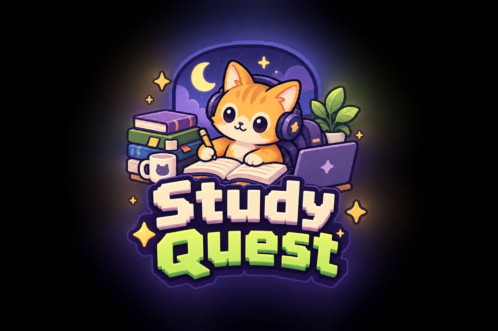

# StudyQuest

## About

StudyQuest turns a big pile of schoolwork into smaller quests. You plan what matters, focus on one task at a time, and see your effort build up through XP, ranks and progress history.

## Features

- Local profile and selectable theme during setup
- Ten themes, including four dark palettes
- Live local clock with 12-hour and 24-hour formats
- Font family, text size and animation preferences
- Quests with search, filters, priorities, due dates and estimated times
- Daily goal meter that tracks quests currently completed today
- Focus timer, escalating XP requirements, persistent level reminders, animated level-up rewards, rank roadmap, streaks, weekly activity and achievements
- Onboarding tour and JSON backup export
- Responsive layout and reduced-motion support

## Assets

Icons are individual SVG files in `assets/icons/`. The study mascot is in `assets/images/study-buddy.png`. The generated StudyQuest logo is `assets/images/studyquest-logo.png`; the compact mascot mark is `assets/images/studyquest-mark.png`. The sidebar logo artwork is original to this project.

## Storage

This is a local prototype. Data is stored in the current browser on the current device. It does not provide account authentication or cloud sync.

## TOS

Every logo and asset is self  made / generated, local ai assistance has been used during this project for uses like debugging, and generating assets.       2026.

## Contact

Instagram : @jonhaliliofficial
Email : jonhaliliofficial@gmail.com
Number : +383 48-250909